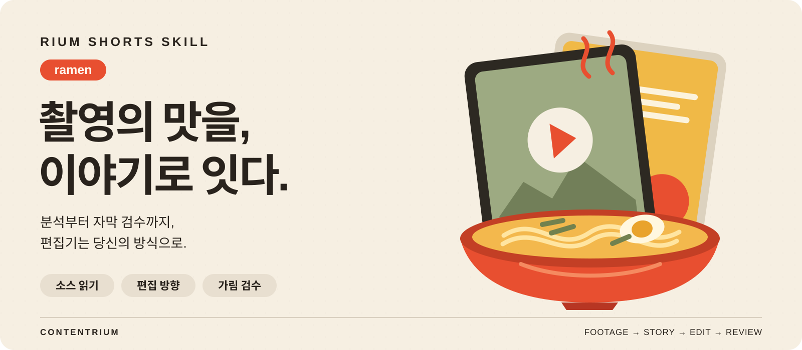
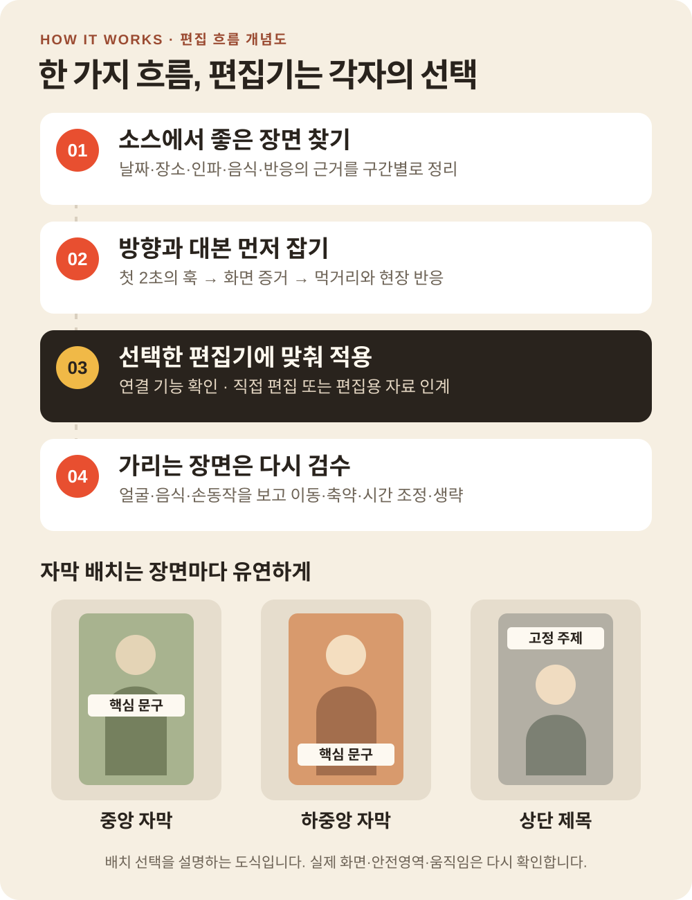

<p align="center">
  
</p>

<h1 align="center">Rium Shorts Skill - ramen</h1>

<p align="center">
  <strong>내 편집기에 맞춰 만드는 라면축제 숏폼</strong><br>
  촬영본 정리부터 첫 2초의 훅, 자막·음악 추천, 얼굴과 음식 가림 검수까지.<br>
  편집자가 쓰는 도구와 작업 환경을 확인하고 다음 편집을 이어갑니다.
</p>

<p align="center">
  <a href="https://github.com/contentriumkorea/rium-shorts-skill-ramen/releases/latest"></a>
  <a href="docs/installation.md"></a>
  <a href="references/editor-workflow.md"></a>
</p>

<p align="center">
  <a href="#빠르게-시작하기">설치하기</a> ·
  <a href="https://github.com/contentriumkorea/rium-shorts-skill-ramen/releases/latest/download/rium-shorts-skill-ramen.zip">다운로드</a> ·
  <a href="#사용-모습">사용 모습</a> ·
  <a href="SKILL.md">상세 안내</a>
</p>

---

## 빠르게 시작하기

`SKILL.md`를 읽는 Codex 또는 Claude Code에서 사용합니다. 실제 편집은 사용 중인 편집기와 연결 가능한 기능에 따라 진행합니다.

<p align="center">
  <a href="https://github.com/contentriumkorea/rium-shorts-skill-ramen/releases/latest/download/rium-shorts-skill-ramen.zip"></a>
</p>

ZIP을 풀어 `rium-shorts-skill-ramen` 폴더를 사용하는 도구의 스킬 디렉터리에 넣으세요. 기존 설치본은 먼저 백업합니다. Git을 쓰는 Windows Codex 새 설치의 기본 경로 예시는 다음과 같습니다.

```powershell
git clone https://github.com/contentriumkorea/rium-shorts-skill-ramen.git "$env:USERPROFILE\.codex\skills\rium-shorts-skill-ramen"
```

[Claude 설치 · 사용자 지정 경로 · 업데이트 안내 →](docs/installation.md)

## 좋은 순간을 찾고, 읽히게 만들고, 다시 고칩니다

| 01 · 촬영본에서 포인트 찾기 | 02 · 장면에 맞는 편집 추천 | 03 · 내 편집기로 수정하기 |
| :--- | :--- | :--- |
| **인파·조리·음식·반응을 선별** | **첫 2초 훅과 유연한 자막** | **편별 프로젝트와 검수 기록** |
| 날짜·시간·장소의 근거를 남기고 쓸 만한 소스 구간을 정리합니다. | 중앙·하중앙·상단 고정 제목을 비교하고, 준비한 BGM과 문장 전개를 큐레이션합니다. | 실제 연결 기능으로 편집하고, 얼굴·음식이 가려지면 위치·길이·노출 시간을 다시 봅니다. |

## 사용 모습

<p align="center">
  
</p>

**자막 위치는 템플릿에 고정하지 않고, 장면의 여백과 움직임에 맞춥니다.**

위 이미지는 실제 앱 화면이 아닌 작업 흐름·자막 배치 개념도입니다. 사용하는 편집기에서 가능한 연결과 가져오기 형식을 확인하고, 직접 편집이 불가능한 단계는 컷표·문구·오디오 계획·수정 지시로 구분해 인계합니다.

<details>
<summary><strong>추가 예시 보기</strong></summary>

| 촬영본에서 발견한 상황 | 추천과 재검수 |
| :--- | :--- |
| 중앙 자막이 면을 들어 올리는 손을 가림 | 상측 여백으로 옮기거나 짧게 줄인 뒤 손의 전체 움직임을 확인 |
| 제목은 비어 보이던 위쪽에 있는데 사람이 고개를 듦 | 문구를 좌측 여백으로 옮기거나 얼굴 등장 전에 종료 |
| 음식과 손·그릇이 화면 대부분을 차지 | 새 문구를 생략하고 음식 디테일과 현장음을 살리는 안을 제안 |
| 여러 편집자가 다른 프로그램으로 같은 편을 수정 | 편 번호, 원본 구간, 선택한 편집기 프로젝트와 시퀀스, 검수 결과를 함께 연결 |

과거 시험의 가림 판단 사례이며, 모든 편집기에서 자동 가림 검출을 검증했다는 뜻은 아닙니다.

</details>

## 스킬 설치·배포 안내

| 방식 | 사용 방법 |
| :--- | :--- |
| Codex | 기본값 `~/.codex/skills/rium-shorts-skill-ramen/`. `CODEX_HOME` 지정 시 그 아래 `skills/` 사용 |
| Claude Code | `~/.claude/skills/rium-shorts-skill-ramen/`에 동일한 스킬 폴더 설치 |
| 사용하는 편집기 | 기존 프로젝트에서 확인하거나 한 번 질문해 결정. 지원되는 연결·스크립트·가져오기 기능을 실제로 확인 |
| 준비 BGM·효과음 | 사용자가 제공한 파일을 우선 분석·선택. 필요할 때 승인된 음성 생성 흐름 사용 |

설치 ZIP은 스킬과 안내 자료입니다. 편집기나 연결 플러그인, 인증정보, 원본 영상·음원은 포함하지 않습니다.

## 이렇게 사용하세요

```text
$rium-shorts-skill-ramen
나는 Premiere Pro로 편집해. 촬영본은 [폴더], BGM은 [음원 폴더].
인파와 라면 조리 중심으로 30초짜리 초벌을 만들어줘.
먼저 훅 문장과 자막 배치 두 가지를 추천해줘.
```

```text
Rium Shorts Skill - ramen으로 04편 수정해줘.
기존 프로젝트의 편집기를 유지하고, 시식하는 얼굴과 그릇이 가려지는
자막의 위치·문장 길이·종료 시점을 다시 검수해줘.
```

## 적용 범위와 제한

- **편집기를 강제하지 않습니다.** 이름을 말한 것만으로 해당 편집기의 자동 조작이 가능한 것은 아닙니다. 연결 도구와 실제 지원 기능을 확인합니다.
- 직접 편집·프로젝트 저장·렌더를 수행한 경우와 인계 자료만 만든 경우를 나눠 보고합니다. 편집기 간 변환은 자막·폰트·효과·속도·오디오 손실 여부를 검수합니다.
- 스킬 자체는 원본 파일을 업로드하지 않습니다. 선택한 편집기·연결 서비스의 클라우드 처리는 별도이며, 업로드 중단 요청을 따릅니다.
- 안전영역과 장면별 배치를 실제 출력에서 다시 확인합니다. 직접 청취, 휴대전화 Instagram UI, 모든 편집기의 자동 편집·재연결·GPU 렌더는 검증 완료로 주장하지 않습니다.
- 원본 영상에 이미 합성된 자막과 새 자막 레이어를 구분합니다. 분석 사례를 제공하는 것이 원본 매체의 재사용 권리를 제공한다는 뜻은 아닙니다.

<details>
<summary><strong>상세 안내와 검증 범위</strong></summary>

- [스킬 작업 순서](SKILL.md) · [편집기 연결·실행](references/editor-workflow.md)
- [편별 프로젝트 관리](references/episode-management.md) · [자막 조합·가림 검수](references/caption-layout-review.md)
- [8편의 편집 분석](references/reference-analysis.md) · [오디오 분석](references/reference-audio-analysis.md)
- [로컬 분석 도우미와 실행 조건](docs/installation.md#로컬-분석-도우미)
- [실제 시험과 현재 미검증 범위](references/editor-test-validation.md) · [변경 기록](CHANGELOG.md)

과거 30초 시험에서 컷 편집·독립 자막과 오디오·가림 수정·출력 파일을 확인했습니다. 그 결과는 당시 편집 환경의 기록이며, 이번 편집기 선택형 지침의 모든 프로그램 연동이 검증됐다는 뜻은 아닙니다.

</details>

<details>
<summary><strong>English overview</strong></summary>

Rium Shorts Skill - ramen guides festival short-form production from footage review and a clear hook within two seconds to flexible captions, prepared music selection and occlusion review. It follows the editor chosen by the user and checks the available integration before editing. When direct editing is unavailable, it prepares explicit handoff material and reports the unexecuted steps. This SKILL.md package does not include a video editor, footage, music or credentials, and does not claim verified automation for every editing application.

</details>

---

<p align="center">
  <strong>CONTENTRIUM · 콘텐츠리움</strong><br>
  <a href="docs/usage-and-rights.md">사용·저작권 안내</a> ·
  <a href="https://github.com/contentriumkorea/rium-shorts-skill-ramen/releases/latest">Latest release</a>
</p>

<sub>별도의 오픈소스 라이선스는 지정하지 않았습니다. 언급된 편집기·서비스의 이름과 상표는 각 소유자에게 속하며, 이 스킬의 공식 제휴를 뜻하지 않습니다.</sub>

<p align="center">
  <a href="https://contentrium.com/"></a>
</p>
