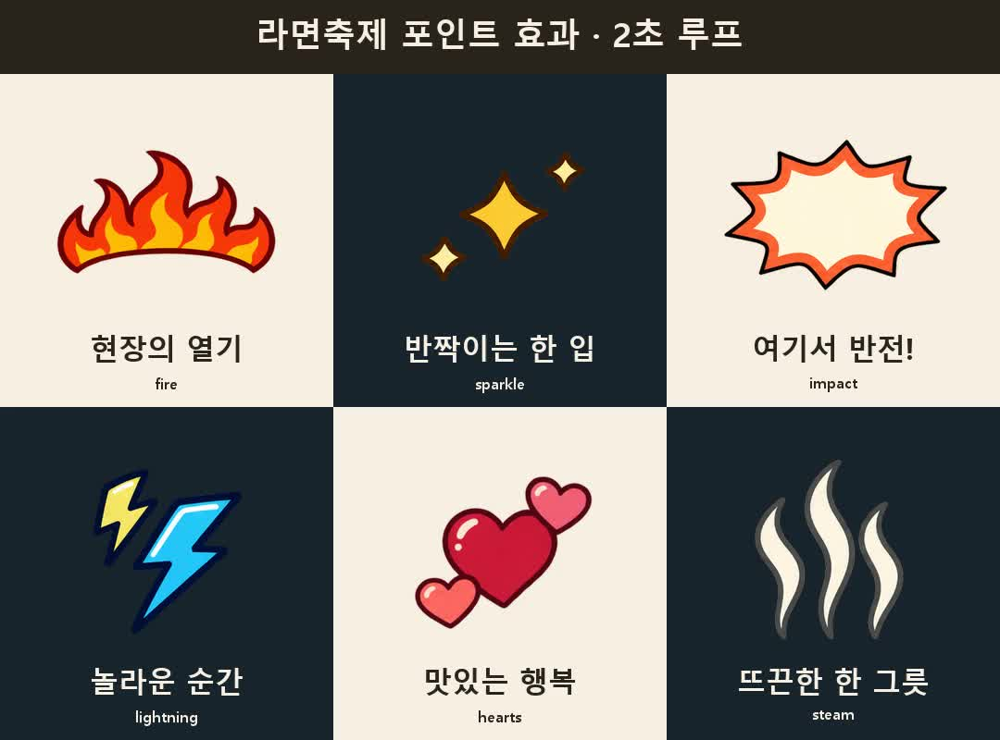

# 라면축제 포인트 효과 · 투명 MOV 6종

불꽃·반짝임·충격 팡·번개·하트·뜨거운 김을 문구와 함께 쓰는 손그림식 반복 효과다. 배포용 영상은 **투명 배경 ProRes 4444 MOV 6개**다. 문구는 에셋에 굽지 않아 편집기 텍스트로 자유롭게 바꿀 수 있다.

**공통 규격:** 444×444 · 24fps · 48프레임 · 2.000초 · 무음 · 스트레이트 알파. 8장 생성 그림을 연결한 제한 프레임 애니메이션이며, 서로 다른 48장을 AI로 생성한 것은 아니다.

| 파일 | 추천 포인트 |
|---|---|
| [fire/fire-alpha-2s.mov](fire/fire-alpha-2s.mov) | 불꽃 — 열기·매운맛 반응·강한 도입의 문구 위 |
| [sparkle/sparkle-alpha-2s.mov](sparkle/sparkle-alpha-2s.mov) | 반짝임 — 음식·제품 발견과 첫 공개 주변 |
| [impact/impact-alpha-2s.mov](impact/impact-alpha-2s.mov) | 충격 팡 — 실제 반전·뜻밖의 반응. 빈 중앙에 짧은 문구를 별도 배치 |
| [lightning/lightning-alpha-2s.mov](lightning/lightning-alpha-2s.mov) | 번개 — 놀람·빠른 변화·활기 있는 행동 옆 |
| [hearts/hearts-alpha-2s.mov](hearts/hearts-alpha-2s.mov) | 하트 — 실제 만족·따뜻한 반응 주변의 여백 |
| [steam/steam-alpha-2s.mov](steam/steam-alpha-2s.mov) | 뜨거운 김 — 뜨거운 음식 관련 문구의 감각적 강조 |

## 넣는 방법

1. 선택한 편집기의 ProRes 4444 알파 지원을 확인하고 MOV를 별도 그래픽 트랙에 놓는다. 녹색 배경이나 크로마키 작업은 필요 없다.
2. 한국어 문구는 독립 텍스트로 만든다. 불꽃은 문구 위, 충격 팡은 짧은 문구 뒤처럼 역할에 맞춰 조합한다.
3. 1080폭 숏폼에서는 효과 폭 200~400px를 출발점으로 보고 피사체에 맞춘다. 444px 원본을 크게 확대해야 하면 필요한 크기로 다시 제작한다.
4. 스트레이트 알파로 해석해 밝고 어두운 바탕에서 가장자리를 확인한다. 검정 외곽선이 있는 디자인이므로 Screen/Add로 검정을 지우지 않는다.
5. 필요한 길이만 잘라 쓰거나 2초 단위로 반복한다. 첫 훅을 효과 때문에 늦추지 말고 불꽃 끝·그림자·최대 움직임까지 얼굴·음식·손·Instagram UI를 가리는지 확인한다. 김은 실제 음식에서 난 것처럼 붙여 상태를 오인시키지 않는다.

MOV를 지원하지 않는 편집기라면 실제로 지원하는 알파 교환 형식으로 변환할 수 있는지 먼저 확인한다. 변환·가져오기 성공 전에는 적용 완료라고 하지 않는다. 편집기 설치나 전환을 강제하지 않는다.

## 검증과 제작

[매니페스트](manifest.json)에 파일 경로·용도·해시·가시 범위와 검증 상태가 있다. MOV 6개의 전체 디코딩·2초 길이·48프레임·무음·실제 알파를 확인했다. 밝고 어두운 바탕의 프레임 표본에서 사각 매트·잘린 외곽을 검사했고 루프 연결이 이웃 포즈 전환임을 대조했다. 브라우저용 내부 합성 미리보기는 재생·표본 화면을 확인했다. 편집기별 임포트·실시간 재생과 실제 촬영본 위 가림 검수는 각 편집 환경에서 확인한다.

제작: Contentrium · 콘텐츠리움. OpenAI 내장 이미지 생성 도구로 새로 제작했으며 모델 버전은 도구에서 표시되지 않았다. 레퍼런스 원본·타인 이모지·폰트 파일은 사용하지 않았다. 제작 단계의 그림과 MP4는 재수정용 작업 기록에 보존하며 이 배포에는 포함하지 않는다. 별도 오픈소스 라이선스 부여를 뜻하지 않는다.

[스킬의 포인트 효과 지침](https://github.com/contentriumkorea/rium-shorts-skill-ramen/blob/main/references/point-graphics.md)
